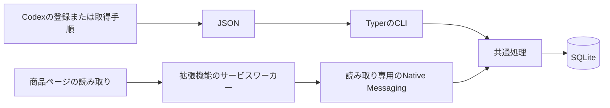

# 構成と判定の境界

Mottetaは、PythonのCLIとSQLiteの台帳、Manifest V3のブラウザ拡張機能で構成します。
Pythonの共通処理が書籍の照合と保存の規則を担当し、CLIとNative Messagingから同じ処理を呼びます。

## 書籍と入手の単位

作品、版と形態、入手記録を分けます。
一つの版を二回買うと入手記録が二件になり、一回で二冊買うと数量が二冊になります。
紙と電子、別巻、別版は、確認した関係に基づいて関連づけます。
PDFとEPUBを含む一度の購入は一件です。

ISBNとサービス内の商品IDは書籍の識別に使います。
購入の再取り込みは、サービスとアカウント、注文と明細の識別子で同じ記録へ対応づけます。
入力が矛盾する識別子は確認候補に残し、確定済みの識別子と区別します。
書名が似ているだけでは、作品、版、購入を自動で統合しません。
両方で分かっている巻が異なる場合は、識別子の一致や書名の類似があっても照合候補から除外します。
巻が不明な場合や紙と電子が異なる場合も、同じ作品の候補として照合します。

サイト発行の明細IDがない場合は、注文全体で商品IDと形態に対応する明細が一件だという取得側の確認に基づく派生キーを使えます。
生成規則の版、注文番号、商品IDの名前空間と範囲、形態を購入先とアカウントで区切り、JSON配列で符号化します。
確認根拠は観測ごとに保存し、新しい観測では一意性を再確認します。
既存購入へのキーの追加は明示的な `bind-identity` または確認対象の `same_acquisition` で行い、購入そのものと識別情報の関連付けを分離します。

## 保存と訂正

SQLiteに、購入先、アカウントの識別名、作品、版、識別子、入手、取得元のキー、依頼ID、観測、訂正、確認対象、取り込み実行を保存します。
書き込みは一つのトランザクションで行い、一意制約と書き込みロックで再試行や同時実行による重複を防ぎます。
手動訂正した項目を保護し、元の観測も残します。
同じ入手の統合では、元の記録を統合先へ関連づけて残すため、以前の依頼を再実行しても購入が増えません。

現在の保存形式は `PRAGMA user_version = 1` です。
アプリ固有の `application_id` と形式の版を検査し、未対応のファイルはエラーにします。

## ブラウザとの境界

### 接続設定の保存先

macOSのChromeでは、Native Messagingのマニフェストを `~/Library/Application Support/Google/Chrome/NativeMessagingHosts/com.motteta.host.json` に登録します。
台帳のデータフォルダーには `browser.json` と起動プログラムの `native-host` を置きます。
起動プログラムには、登録コマンドを実行したPythonと台帳の場所を絶対パスで固定します。
一つの登録から照会する台帳は一つです。
利用者向けの登録と復旧の手順は[初期設定](setup.md)と[保存とトラブル対処](operations.md)を参照してください。

### 読み取り専用の通信

コンテンツスクリプトが抽出するのは、現在の商品本体の書籍情報です。
サービスワーカーは拡張機能ID、トップフレーム、対象URLを検証してから、固定した照会操作だけをネイティブプログラムへ送ります。
ポップアップ用の詳細取得は、拡張機能自身のポップアップからだけ受け付けます。
照会プログラムは登録した呼び出し元を検査し、`check` と `status` 以外を拒否します。

通信はネイティブのバイト順の32ビット長とUTF-8のJSONを使います。
要求は64 KiB、応答は512 KiBを上限とします。
一回の `sendNativeMessage` に一回の応答を返し、診断を標準出力へ混ぜません。

ページへ返すのは判定と短い表示だけです。
詳細は拡張機能のポップアップで表示します。

## サービスを増やすとき

購入先は `source` のデータとして追加します。
一括取得はCodex向けの手順と共通JSONへの変換、商品ページの対応は拡張機能の読み取り処理として、それぞれ独立して追加します。
各サイトの読み取り処理は拡張機能に同梱します。

拡張機能のサービス固有の設定と処理は、`src/adapters/services/` の各フォルダに置きます。
ビルド時に各フォルダを収集し、共通のレジストリへ渡す登録コードと、manifestのアクセス権限および自動実行対象を生成します。
表示位置、ドメイン、サイト固有のCSSセレクターもアダプターで定義します。
手順と型の契約は [ブラウザアダプターの追加手順](browser-adapters.md)に記載しています。
